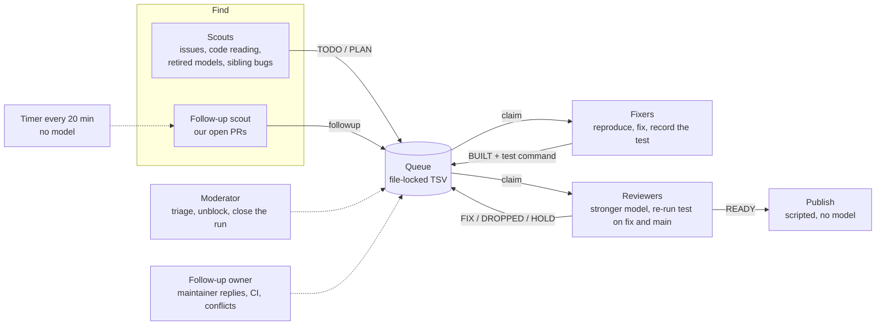

# The pipeline behind the pull requests

Most pull requests in this dataset were found, fixed and reviewed by a multi-agent system I
designed and operate: a set of Claude Code sessions with fixed roles, coordinated through a
shared queue on one Linux (WSL) machine. This page describes how it works, what it depends on
and what its numbers say. It is a technical description: the scripts and prompts stay private,
and no organisation or person is named. The public, general version of the idea is
[tanda](https://github.com/pcbeingused333/tanda).

Snapshot of the design as of 2026-11-04. Synced with the private system about every two weeks.

## Shape

| Role | Model | Job |
| --- | --- | --- |
| Scouts (2–5) | Sonnet | Find bugs users hit in current `main`: maintainer-labelled issues, code reading in repos that already merge our work, provider changes (retired models, rejected parameters), siblings of a fixed bug. Each candidate is checked for duplicates and repo limits before it enters the queue. |
| Follow-up scout | Sonnet | Turn events on our open PRs (review requests, conflicts, CI failing on our code) into queue rows. |
| Fixers (2–3) | Sonnet | Reproduce in an isolated git worktree, write the smallest fix in the repo's style, run the test red on `main` and green on the fix, record the exact command. A row cannot reach `BUILT` without it. |
| Reviewers (1–3) | Opus | Re-run the fixer's test on the fix and on `main`, judge user impact, diff size and duplicates, correct the PR text. `READY`, `FIX` with a concrete note, `DROPPED` or `HOLD` for a human. |
| Moderator | Opus | Triage `PLAN` rows, unblock stuck ones, publish, write the closing report with the run's metrics. |
| Follow-up owner | Sonnet | Owns every open PR until it is merged or closed: answers reviews, fixes CI, rebases. |
| Editor | on demand | Rewrites the role prompts when rules change, so changes do not pile up as dated patches. |

Queue states: `TODO → CLAIMED → BUILT → REVIEW → READY → PUBLISHED`, plus `PLAN` (a reviewer
writes a five-line plan before anyone codes), `FIX`, `ISSUE-WAIT` (issue first, PR after the
maintainer answers), `HOLD` and `DROPPED`. Roles may only set the states their prompt allows.

## Modes

| Mode | What runs | When |
| --- | --- | --- |
| Batch | All roles until a ceiling of new PRs is published, then the moderator closes the run | Daytime, early weeks |
| Continuous | Same roles, a higher ceiling (75 new PRs), sessions stay up; a systemd timer every 20 minutes runs follow-up checks, open-PR sweeps, disk clean-up and usage-limit alerts without any model | Daytime, since 2026-11-01 |
| Maintenance | No scouts and no new PRs: the follow-up scout queues work on our open PRs (conflicts, maintainer questions, CI our fault), two fixers and one reviewer handle it, the follow-up owner publishes. Closes when nothing is left or after two hours | Overnight, since 2026-11-02 |

Maintenance exists because open PRs pile up: 289 open on 25 October, about 600 on 4 November.
A PR left with an unanswered question or a conflict does not get merged, so keeping them moving
is worth more than opening new ones.

## Rules the agents work under

- **Only fixes maintainers want.** Issues the team opened, labelled or confirmed, or bugs
  reproducible on current `main`. Speculative clean-ups are dropped at triage.
- **Volume caps.** At most 12 open PRs per repository, fewer where a maintainer asked; some
  organisations are paused entirely; at most one retired-model PR per repo per run.
- **AI policies respected.** Repositories whose contribution guide rejects AI-assisted work are
  skipped. PR descriptions disclose AI involvement in neutral wording; on repos with a CLA no
  co-author trailer is added.
- **One writer to GitHub.** Workers have read-only GitHub access through a rate-limit wrapper;
  only the moderator and the follow-up owner publish.
- **Reminders are rationed.** A nudge on a stalled PR goes out only at the nightly close, at
  most once per repository every three weeks, and never to projects that asked for none.

## What it depends on

Claude Code CLI sessions in Windows Terminal panes on WSL Ubuntu · `gh` behind a wrapper that
queues calls under GitHub's rate limits · git worktrees per fix · per-repo virtualenvs and
Docker images for running upstream test suites · about 30 small Python and shell tools (queue
with a file lock, duplicate check, repo eligibility, open-PR sweep, publisher, metrics, cost
from session transcripts, disk clean-up) · a systemd user timer · nightly backup of scripts and
state to a private repository.

## Numbers

[`runs.csv`](runs.csv) has one row per run; [`daily_cost.csv`](daily_cost.csv) one row per
day. Model cost is estimated at API prices from the session transcripts.

40 runs between 25 October and 4 November 2026 (35 batch, 2 continuous, 3 maintenance):

| | |
| --- | --- |
| Hours of runs | 112 |
| New PRs published | 643 |
| Follow-ups published | 292 |
| 30-day merge rate (of PRs decided) | 87–89% |
| Model cost | about $2,500, or $2.40–5 per published PR in recent runs |

Decisions the numbers drove:

- **Triage before build.** Building a fix and dropping it afterwards was the most expensive
  mistake, so candidates are verified before a fixer touches them.
- **Reviewers on a cheaper model.** A side-by-side test gave nearly the same verdicts for about
  2.5× less.
- **Context is the cost.** 52–76% of the bill is cache reads from long sessions re-reading their
  context. Average context per request fell from about 290k tokens (20 October) to about 64k
  (4 November) by trimming prompts and telling each role exactly which notes to read.
- **Merges, not PRs.** Success is measured by merges and by open PRs going down, which is why
  the ceiling on new PRs dropped while open PRs were above ~400, and why maintenance mode exists.

## Known problems and the next design

Long-lived sessions that wait on a queue cost almost as much idle as working, nobody watches
the fleet (a reviewer that fails to start goes unnoticed), and orchestration rules live inside
long prompts. The next design separates the deterministic parts from the ones that need
judgment: collectors without a model fill a SQLite store of candidates on a timer, a supervisor
starts one short-lived `claude -p` worker per queue row and role, publishing stays scripted, and
a health check watches processes, disk and rate limits. tanda is the first step of that design.
